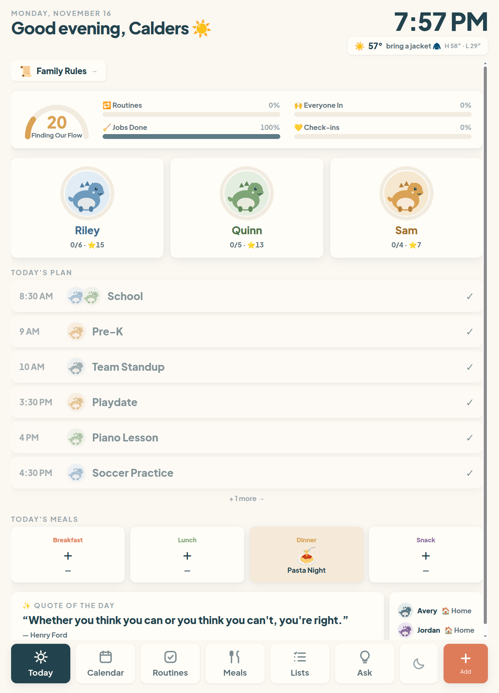
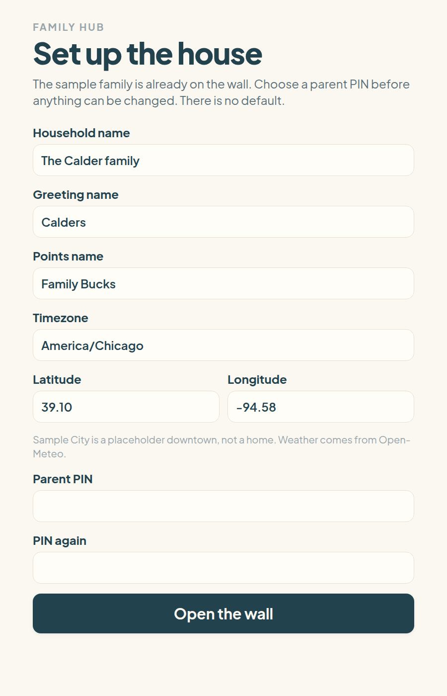
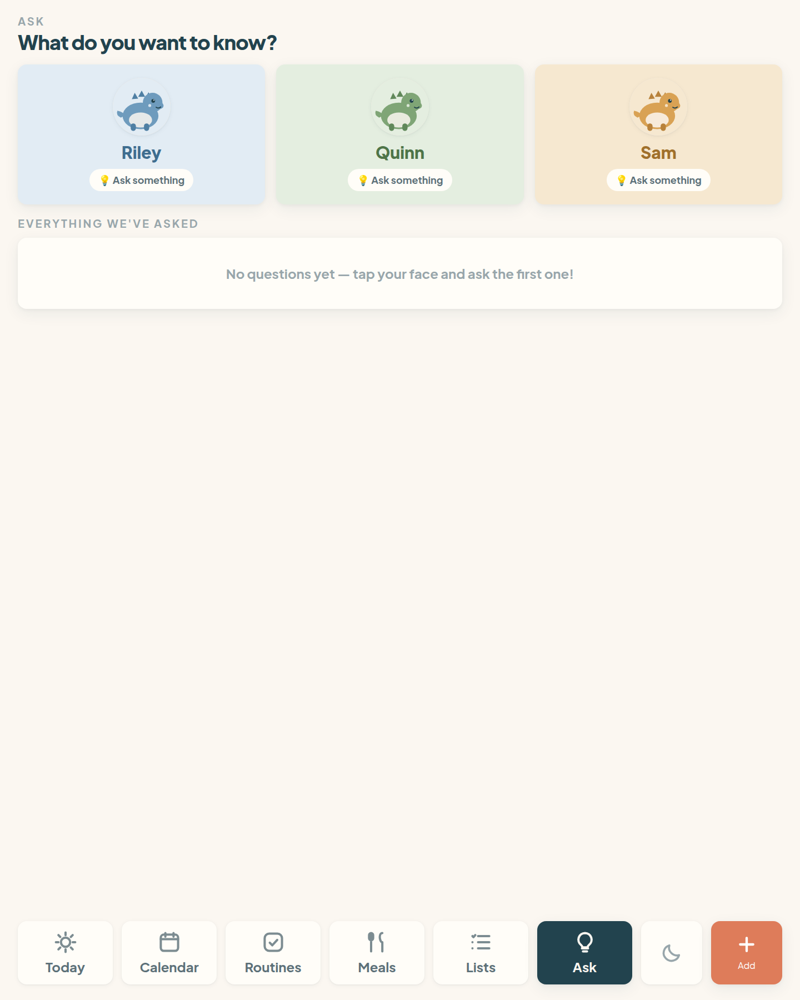

# Family Hub

Family Hub is a self-hosted wall for one household. It is the day at a glance: weather, who is where, what is for dinner, routines, meals, lists, a reading shelf, Family Bucks, and Ask the Hub. It does not need a subscription.

The first start asks for a household name, a parent PIN, and your family: try it with the fictional sample family (the Calders) or enter your own kids and parents. Cartoon avatars stand in until you add photos.



## For someone setting this up at home

You need [Docker](https://docs.docker.com/get-docker/). In this folder:

```bash
docker compose up --build
```

Open http://127.0.0.1:3847.

1. On the setup screen, choose **Try it with the sample family** or **Set up my family** (1 to 8 kids, 1 to 4 parents).
2. Choose a parent PIN. There is no default. `1234` and straight lines of numbers are rejected. The PIN is stored as a hash. Wrong tries are rate-limited (see [SECURITY.md](SECURITY.md)). Each screen asks for the PIN once and then stays unlocked for 30 days.
3. The wall opens on Today. The tabs along the bottom are Today, Calendar, Routines, Meals, Lists, and Ask. The moon button starts the screensaver. Add creates an event or a routine.
4. Kids can check off their own routines. Parent actions (rewards, rules, deleting events) ask for the parent PIN.

The household database stays in the Docker volume `familyhub-data`. Updating the app does not erase it.

### Weather

The sample point is a downtown in the central United States, labeled in setup. Change the latitude, longitude, and timezone there. Forecasts come from Open-Meteo.

### Calendar

Each person's secret iCal address is stored as the setting `ics_url_<member id>` in the database (a settings screen is planned). Family Hub fetches those links from the machine it runs on and refuses addresses on a private network.

### Photos and avatars

Put pictures in the `photos` folder next to `docker-compose.yml` (mounted at `/photos` in the container). Until a photo exists, each person shows a cartoon avatar.

### Ask the Hub

Questions are saved on the wall. To have a model answer them, set one of these and restart:

- `ANTHROPIC_API_KEY` for Claude
- `OLLAMA_URL` for a local model, for example `http://host.docker.internal:11434`

The assistant bridge listens only on `127.0.0.1` inside the container and requires `BRIDGE_TOKEN`. If neither model is set, the question is still saved.

### What this is not

- There is no default PIN and no cloud account.
- Photos are files on disk. Nothing is pulled from a file-sync service.
- There is no desktop calendar sync tool. Calendars are iCal links.
- Sign-in with Google is not built. See [SECURITY.md](SECURITY.md).

## For a developer

Requirements: Node.js 22, and build tools for the SQLite addon (`python3`, `make`, `g++`).

```bash
npm ci
cp .env.example .env
npm run dev
```

That starts the wall on port 3847 and the assistant bridge on `127.0.0.1:8787`. Empty secrets are generated under `data/`, which is gitignored. The database is `data/family-hub.db`.

```bash
npm run lint
npm run typecheck
npm test
npm run build
node scripts/check-pii.mjs
```

### Layout

| Path | Role |
| --- | --- |
| `src/app/today` | The wall's home: weather, rhythm, routines, spark, dinner |
| `src/app/my-day` | Routine and job editor, buckets, values |
| `src/app/calendar` | Week and month, plus wall-created events |
| `src/lib/spark.ts` | Quote of the Day rotation and optional bridge refill |
| `src/lib/db.ts` | SQLite schema and the Calder sample seed |
| `src/lib/queries.ts` | Ledger, routines, meals, books |
| `bridge/ask-bridge.mjs` | Local assistant. Localhost and `BRIDGE_TOKEN` only |
| `public/demo-avatars` | Cartoon stand-ins, one per sample person |

People are stored in the database (`src/lib/household.ts`) and entered at setup. Colors come from a fixed palette (`src/lib/member-theme.ts`).

## Screenshots

The sample Calder family, not a real household.






## License

[MIT](LICENSE). Copyright 2026 Family Hub contributors. Change that line if you want a different copyright holder.
